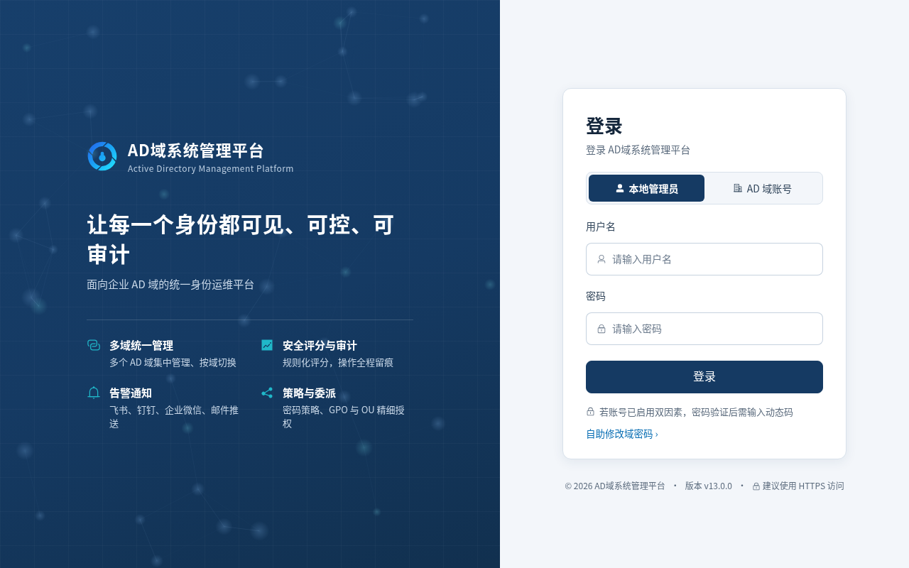
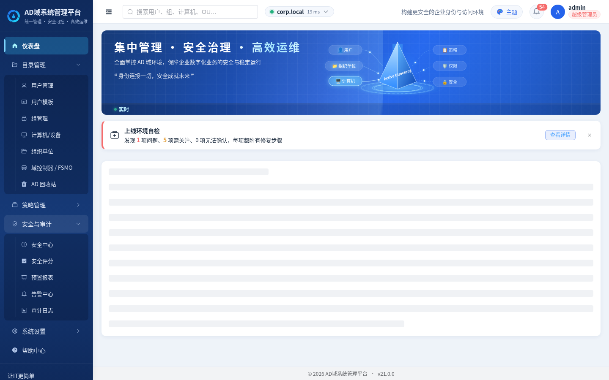
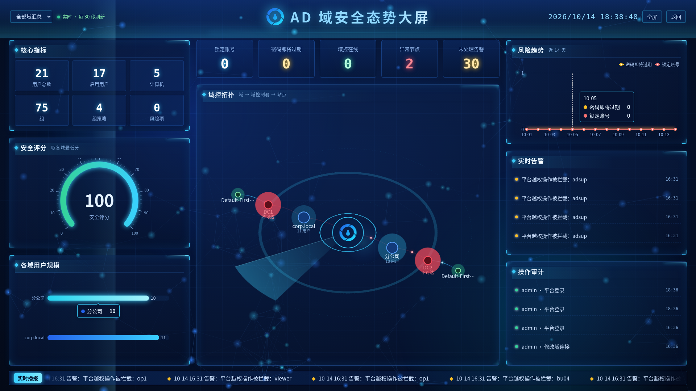
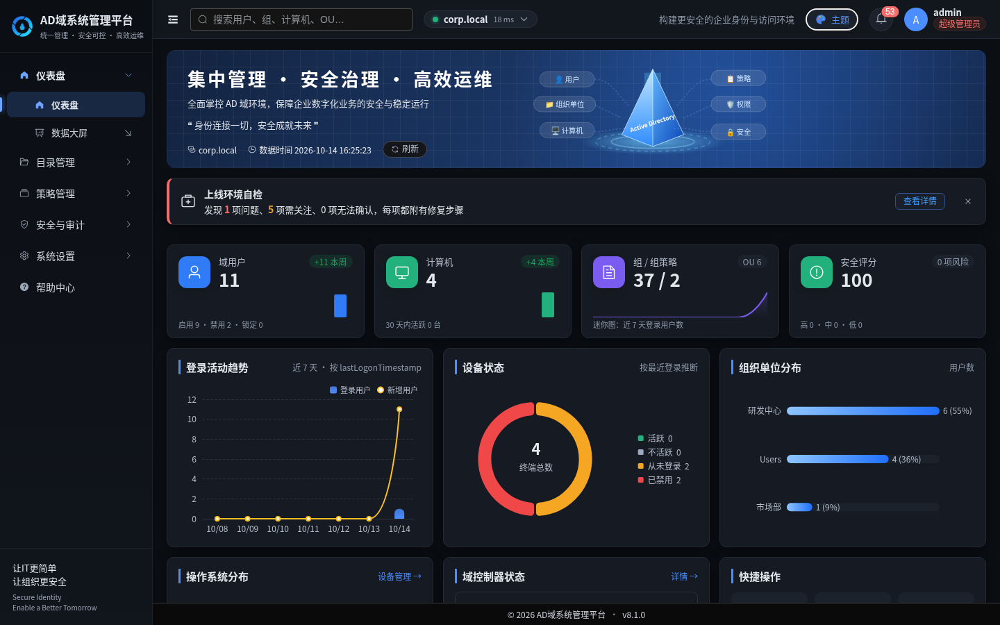
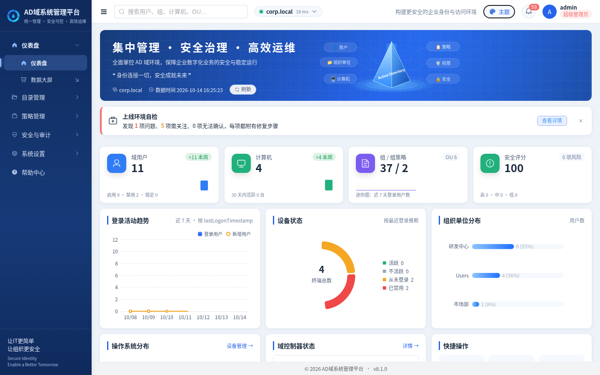
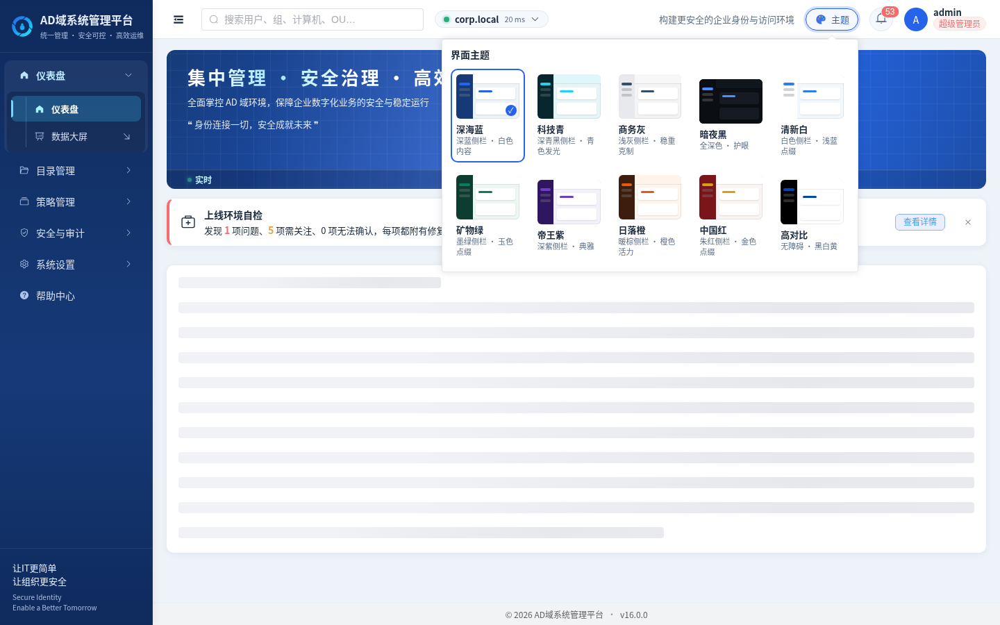
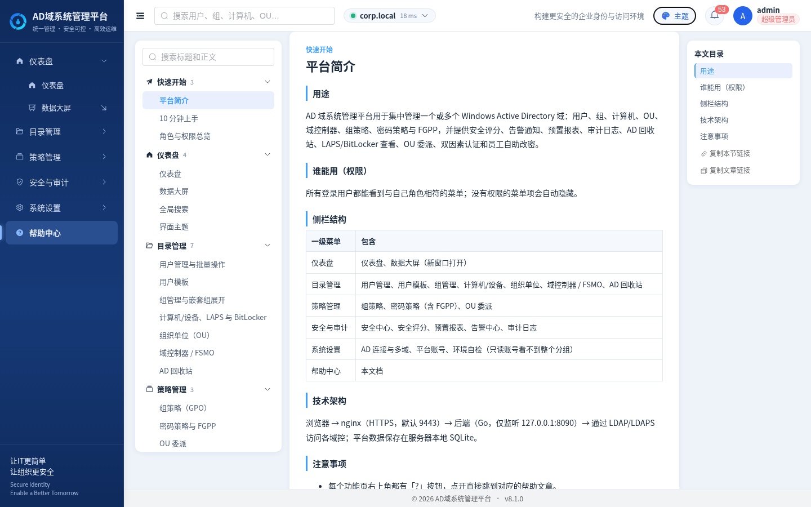
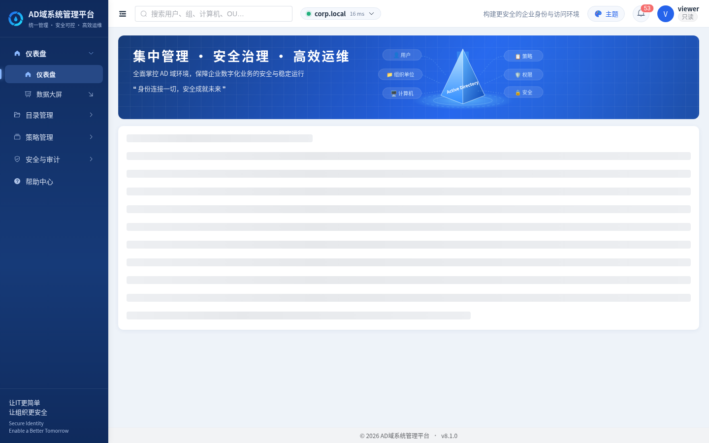
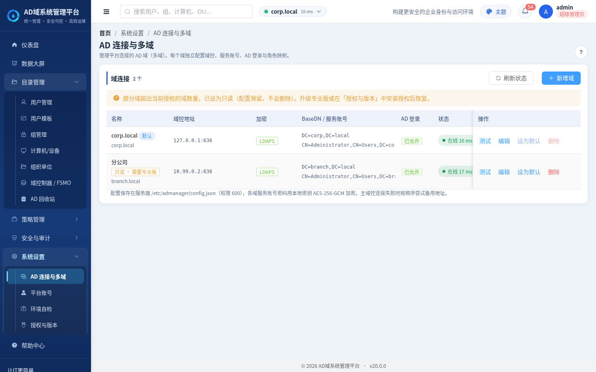
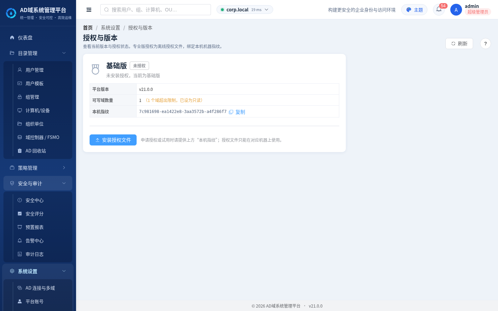

# AD 域管理平台（AD Manager）

本仓库是**对外主页**：使用教程、界面预览与 [GitHub Releases](https://github.com/Aidan-996/ad-manager-releases/releases) 安装包。  
**不含应用程序源码**（源码在私有仓库维护）。

应用内「检查更新」默认查询本仓库 Releases，一般**无需** GitHub Token。  
**当前版本：v23.2.11**（统一安装包）。

---

## 它能做什么

面向 Windows / macOS 本机或内网运维人员的 **Active Directory 图形化管理**：目录对象、策略浏览、安全巡检、报表与审计等。同一安装包即可使用；若采购了专业版能力，在「授权与版本」中导入供应商提供的 `.lic` 后解锁对应功能。

| 场景 | 说明 |
|---|---|
| 日常账号运维 | 用户 / 组 / 计算机 / OU 的查询与变更、重置密码、启停解锁 |
| 策略与安全 | 组策略浏览、密码策略 / FGPP、安全评分与风险检查 |
| 仪表盘 | 锁定、密码即将过期、已过期等待处理卡片 |
| 扩展能力（需授权） | 多域、回收站、告警、数据大屏、定时报表、LAPS/BitLocker 及专业增值模块等 |

完整能力对照见 [docs/FEATURES.md](./docs/FEATURES.md)。

---

## 界面预览

### 登录

首次安装默认账号：**`admin`** / **`admin123`**（登录后会要求修改密码）。

### 工作台 / 仪表盘

### 数据大屏（授权后）

### 主题

支持多套主题，可在界面中切换：

| 深色 | 海洋 |
|---|---|
|  |  |

### 帮助中心

### 系统设置（只读账号示例）

### 授权与版本（查看版本 / 导入许可）

---

## 快速开始（Windows 推荐）

1. 打开 [Releases](https://github.com/Aidan-996/ad-manager-releases/releases)，下载当前版本的  
   **`ad-manager-*-windows-amd64-setup.exe`**（主安装包）。
2. 双击安装。建议装到默认目录；**升级时请装回同一目录**，以保留 `data/`（配置、数据库、证书、已导入的许可文件）。
3. 启动后浏览器打开本机地址（默认 HTTPS `https://127.0.0.1:9443/`）。
4. 使用 `admin` / `admin123` 登录并改密，再在「系统设置 → AD 连接」填写域控与绑定账号。

更细的参数、重置管理员、离线升级与 SmartScreen 说明见  
[docs/WINDOWS-LOCAL.md](./docs/WINDOWS-LOCAL.md)。

### macOS

下载 `ad-manager-*-darwin-*.dmg`（或 zip），按 [docs/MACOS-LOCAL.md](./docs/MACOS-LOCAL.md) 打开运行。

### 安装包怎么选

| 文件 | 用途 |
|---|---|
| `ad-manager-*-setup.exe` | **推荐**：Windows 安装/覆盖升级 |
| `ad-manager-*-windows-amd64.zip` | 绿色解压；勿删同级 `web/` 与日后的 `data/` |
| `ad-manager-pro-*` | 与主包**同内容**的过渡别名（旧专业版客户端检查更新用） |
| `*.sha256` | 校验下载完整性 |

> 自 v23.2.10 起为**统一安装包**：一份 setup 即可；未导入许可时使用标准能力，导入有效 `.lic` 后解锁已采购的专业能力。

---

## 文档索引

| 文档 | 说明 |
|---|---|
| [docs/FEATURES.md](./docs/FEATURES.md) | 功能介绍与档位对照 |
| [docs/WINDOWS-LOCAL.md](./docs/WINDOWS-LOCAL.md) | Windows 安装 / 更新 / 重置 |
| [docs/MACOS-LOCAL.md](./docs/MACOS-LOCAL.md) | macOS 本地包 |
| [docs/RELEASES.md](./docs/RELEASES.md) | 发版约定与在线更新 |
| [docs/architecture.md](./docs/architecture.md) | 交付模型公开摘要 |

---

## 版本摘要

| 版本 | 要点 |
|---|---|
| **v23.2.11** | 统一包维护更新；机器绑定更稳健；换机请用新指纹联系供应商重签许可 |
| v23.2.10 | 统一安装包；`.lic` 解锁 Pro；Pro 菜单仅在授权有效时显示 |
| v23.2.9 | 授权校验加固（应用内） |
| v23.2.8 | API 令牌（Bearer），便于脚本调用 |
| v23.2.7 | 仪表盘待处理卡片；安装器抛光；一键应用更新 |
| v23.2.6 | 默认更新源为本仓库；源码仓私有 |
| v23.2.5 | 在线更新与功能介绍对齐 |
| v23.2.4 | Windows 自签名；授权页档位说明 |
| v23.2.3 – v23.2.0 | 登录体验、本地包与安装器持续改进 |

各版本资产与说明见对应 [Release](https://github.com/Aidan-996/ad-manager-releases/releases) 正文。

---

## 许可与支持

- 本仓库中的**文档与教程**见根目录 [LICENSE](./LICENSE)。
- **应用程序**按安装包内许可与商业条款；专业能力需向供应商取得 `.lic`。
- 换机、重装或迁移后若提示许可与本机不符：在「授权与版本」复制指纹与实例 ID，联系供应商重新签发即可。

---

*截图来自产品界面，随版本可能略有差异；以当前安装包内界面为准。*
